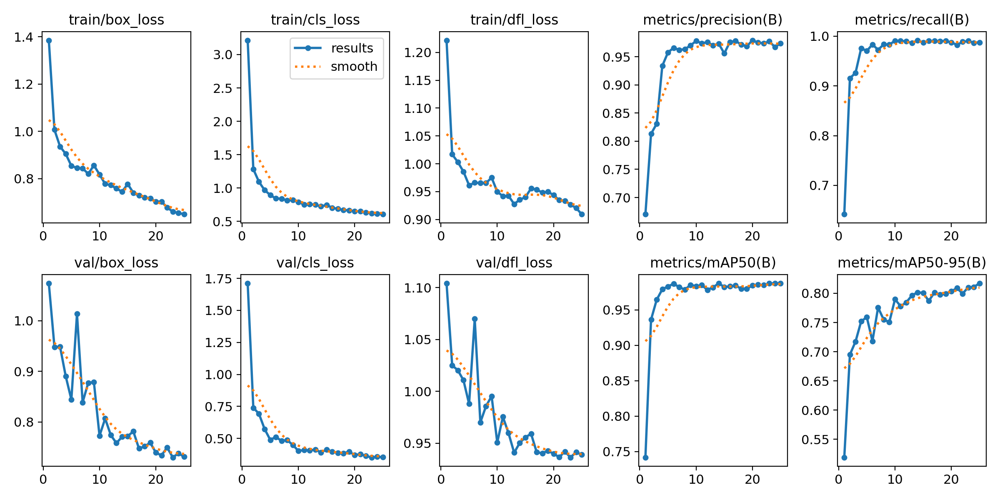
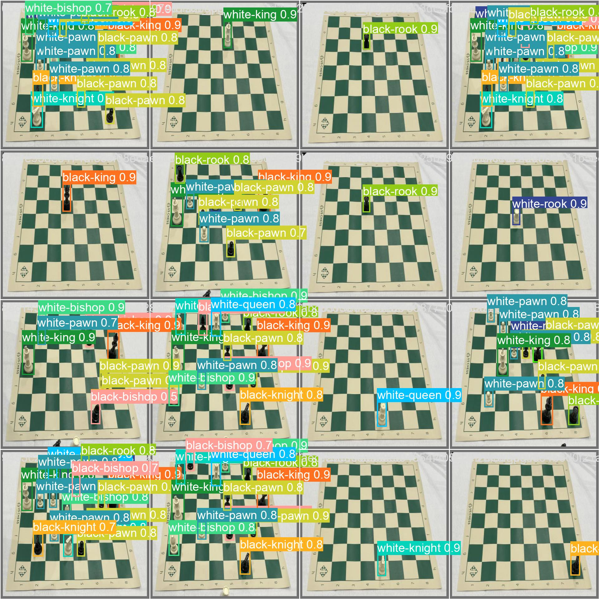

# roboflowChess — Chess Piece Detection with YOLOv8

[](https://colab.research.google.com/github/TheFl1y/roboflowChess/blob/main/Yolo_V8_training.ipynb)

## 專案簡介｜Project Overview

`roboflowChess` 是一個使用 **Ultralytics YOLOv8** 與 **Roboflow** 建立的西洋棋棋子物件偵測專案。它的主要目標不是實作棋局規則或棋譜分析，而是讓電腦從棋盤影像中找出每一顆棋子的位置，並辨識棋子的顏色與種類，例如白國王、黑皇后、白騎士或黑士兵。

`roboflowChess` is a chess-piece object detection project built with **Ultralytics YOLOv8** and **Roboflow**. Its purpose is not to implement chess rules or analyze moves. Instead, it trains a computer vision model to locate every piece in a chessboard image and classify its color and type, such as a white king, black queen, white knight, or black pawn.

除了完整的資料下載、模型訓練、驗證與推論流程之外，本專案也包含一項標籤雜訊實驗：程式會隨機修改部分訓練標籤，再比較正常資料與錯誤標記資料所訓練出的模型。這項實驗可用來觀察資料品質對物件偵測模型準確度與穩定性的影響。

In addition to the complete dataset download, training, validation, and inference workflow, this project includes a label-noise experiment. A portion of the training labels is randomly changed so that models trained with clean and corrupted annotations can be compared. This makes the repository useful for studying how annotation quality affects the accuracy and reliability of an object detection model.

## 主要功能｜Key Features

- 使用 YOLOv8s 訓練自訂西洋棋棋子偵測模型。<br>
  Trains a custom chess-piece detector with YOLOv8s.
- 使用 Roboflow 匯出的 YOLOv8 格式資料集。<br>
  Uses a Roboflow dataset exported in YOLOv8 format.
- 辨識 13 個類別，涵蓋黑白雙方的主要棋子類型。<br>
  Detects 13 classes covering the main black and white chess-piece types.
- 隨機修改 10% 的類別標籤，以測試標籤錯誤造成的影響。<br>
  Randomly changes 10% of class labels to examine the impact of annotation errors.
- 保存訓練曲線、混淆矩陣、驗證影像與最佳模型權重。<br>
  Stores training curves, confusion matrices, validation images, and the best model weights.
- 提供可在 Google Colab 執行的 notebook，方便重現實驗。<br>
  Provides a Google Colab notebook for reproducing the experiment.

## 資料集｜Dataset

資料集位於 `testset/Chess-Pieces-6/`，由 Roboflow 匯出，共包含 **693 張已標註影像**。影像與標註採用 YOLOv8 格式，可直接用於 Ultralytics 的訓練與驗證流程。

The dataset is stored in `testset/Chess-Pieces-6/` and was exported from Roboflow. It contains **693 annotated images** in YOLOv8 format and can be used directly with the Ultralytics training and validation workflow.

資料集包含以下 13 個類別：

The dataset contains the following 13 classes:

```text
bishop
black-bishop, black-king, black-knight, black-pawn, black-queen, black-rook
white-bishop, white-king, white-knight, white-pawn, white-queen, white-rook
```

影像已進行方向校正並縮放為 416 × 416；資料增強包含水平翻轉與亮度調整。資料集標示為 Public Domain。Repository 內其他程式碼與模型檔案目前未另外指定授權。

The images were auto-oriented and resized to 416 × 416. Dataset augmentation includes horizontal flipping and brightness adjustment. The dataset is marked as Public Domain. The other code and model files in this repository do not currently have a separately specified license.

## 訓練設定與成果｜Training Configuration and Results

Repository 內保存的訓練紀錄使用 YOLOv8s 預訓練權重，訓練 25 個 epochs，輸入尺寸為 800，batch size 為 16。下列數值來自 `runs/detect/train/results.csv` 的最後一個 epoch。

The saved training run uses YOLOv8s pretrained weights for 25 epochs with an input size of 800 and a batch size of 16. The metrics below are taken from the final epoch in `runs/detect/train/results.csv`.

| 項目 / Metric | 結果 / Value |
| --- | ---: |
| Model | YOLOv8s |
| Epochs | 25 |
| Input size | 800 |
| Batch size | 16 |
| Precision | 97.39% |
| Recall | 98.71% |
| mAP@50 | 98.76% |
| mAP@50–95 | 81.70% |

### 訓練曲線｜Training Curves



### 驗證預測範例｜Validation Predictions



## 快速開始｜Quick Start

最簡單的執行方式是點選頁面上方的 **Open in Colab**，再將 Colab 執行環境切換為 GPU。Notebook 包含套件安裝、資料集下載、模型訓練、驗證、推論以及 Roboflow 部署範例。

The easiest way to run the project is to select **Open in Colab** at the top of this page and switch the Colab runtime to a GPU. The notebook covers package installation, dataset download, model training, validation, inference, and a Roboflow deployment example.

在 Colab 執行前，請先在左側「Secrets」新增名稱為 `ROBOFLOW_API_KEY` 的金鑰，並允許 notebook 存取。
Before running in Colab, add your key as `ROBOFLOW_API_KEY` under **Secrets** and grant notebook access.

### 本機安裝｜Local Installation

```bash
git clone https://github.com/TheFl1y/roboflowChess.git
cd roboflowChess
python -m venv .venv
```

啟用虛擬環境後，安裝 notebook 使用的套件：

After activating the virtual environment, install the packages used by the notebook:

```bash
pip install ultralytics==8.0.196 roboflow
```

### 使用現有權重推論｜Run Inference with the Saved Weights

將 `source` 改成要辨識的影像或資料夾路徑：

Replace `source` with the path to the image or directory that you want to analyze:

```bash
yolo task=detect mode=predict \
  model=runs/detect/train/weights/best.pt \
  source=/path/to/chess-image.jpg \
  conf=0.25
```

推論結果預設會輸出至 `runs/detect/predict/`。

Prediction results are saved to `runs/detect/predict/` by default.

### 重新訓練｜Retrain the Model

```bash
yolo task=detect mode=train \
  model=yolov8s.pt \
  data=testset/Chess-Pieces-6/data.yaml \
  epochs=25 \
  imgsz=800
```

## 標籤雜訊實驗｜Label-Noise Experiment

Notebook 中的 `modify_labels_randomly_with_logging` 函式會從訓練資料的標註檔中隨機選取約 10% 的物件，並將其類別替換成另一個隨機類別，同時把修改前後的資訊記錄到 `modification_log.txt`。透過比較正常標籤與錯誤標籤的模型版本，可以分析錯誤資料對模型訓練與預測的影響。

The `modify_labels_randomly_with_logging` function in the notebook randomly selects approximately 10% of the annotated objects and replaces each selected class with another random class. Every change is recorded in `modification_log.txt`. Comparing model versions trained with clean and corrupted labels helps demonstrate how incorrect data can affect training and prediction quality.

## Repository 結構｜Repository Structure

```text
roboflowChess/
├── Yolo_V8_training.ipynb       # Colab training, validation, and inference workflow
├── testset/Chess-Pieces-6/      # Chess-piece dataset in YOLOv8 format
├── runs/detect/train/           # Training results, plots, and model weights
├── runs/detect/val/             # Validation results
├── yolov8n.pt                   # YOLOv8 Nano pretrained weights
└── yolov8s.pt                   # YOLOv8 Small pretrained weights
```

## 注意事項｜Notes

- 大型模型權重與完整資料集會占用較多儲存空間。<br>
  Model weights and the full dataset require a significant amount of storage.
- 使用 Roboflow API 時，請透過環境變數或 Colab Secrets 管理 API key，不要把金鑰直接寫入公開程式碼。<br>
  When using the Roboflow API, store the API key in an environment variable or Colab Secrets instead of hard-coding it in public source code.
- 若使用較新的 Ultralytics 版本，部分指令或輸出格式可能與原始 notebook 不同。<br>
  Newer Ultralytics releases may use commands or output formats that differ from the original notebook.

## 相關資源｜References

- [Ultralytics YOLO Documentation](https://docs.ultralytics.com/)
- [Roboflow](https://roboflow.com/)
- [Google Colab](https://colab.research.google.com/)
